# EquityCart — System Design & Scaling (Interview Guide)

> A walkthrough you can use in a system-design / backend interview to explain **what EquityCart is, how it is built, how data flows, how every database is mapped, and how it scales**.
> All facts below are derived from the code in `equitycart/`, `equitycart-config/` and `equitycart/docker/`.

---

## Table of Contents

1. [Elevator Pitch](#1-elevator-pitch)
2. [Functional & Non-Functional Requirements](#2-functional--non-functional-requirements)
3. [High-Level Architecture](#3-high-level-architecture)
4. [Service Catalogue](#4-service-catalogue)
5. [Service Relationship Diagram (sync + async)](#5-service-relationship-diagram)
6. [Database-per-Service Mapping](#6-database-per-service-mapping)
7. [Detailed ER Diagrams & Table Mappings](#7-detailed-er-diagrams--table-mappings)
8. [NoSQL, Cache & Messaging Data Mapping](#8-nosql-cache--messaging-data-mapping)
9. [Cross-Service (Logical) Relationships](#9-cross-service-logical-relationships)
10. [Key Business Flows (Sequence Diagrams)](#10-key-business-flows)
11. [Patterns Used & Why](#11-patterns-used--why)
12. [Consistency, Concurrency & Idempotency](#12-consistency-concurrency--idempotency)
13. [Security Design](#13-security-design)
14. [Observability](#14-observability)
15. [Scaling Strategy](#15-scaling-strategy)
16. [Failure Modes & Resilience](#16-failure-modes--resilience)
17. [Trade-offs, Known Gaps & Evolution](#17-trade-offs-known-gaps--evolution)
18. [Interview Q&A Cheat Sheet](#18-interview-qa-cheat-sheet)

---

## 1. Elevator Pitch

**EquityCart** is an e-commerce platform where every purchase earns the customer **fractional shares ("stock-back")** of the brand they bought from (buy Nike shoes → earn a fraction of `NKE`).
Customers can then **trade**, **gift**, set **price alerts** on, or **sell those shares to pay for new orders ("Sell-to-Spend")**.

It began as a **modular monolith** (`app` module, one DB) and was decomposed into **Spring Boot microservices** (strangler-style), each owning its own database, communicating via **OpenFeign (sync)** and **Kafka (async)**, fronted by **Spring Cloud Gateway**, discovered via **Eureka**, configured via **Spring Cloud Config**.

---

## 2. Functional & Non-Functional Requirements

| Functional | Non-Functional |
|---|---|
| Register / login / refresh / logout (JWT + Keycloak) | Never oversell inventory (strong consistency on stock) |
| Product catalog (brands, categories, products, CSV import) | Money/shares must balance → double-entry ledger |
| Cart (Redis) → Order → lifecycle (ship, deliver, return, refund) | Exactly-once *effect* for events (idempotent consumers) |
| Flash sale with high contention | Survive partial failures (sagas + compensation) |
| Stock-back reward granted on delivery, vests later, clawed back on return | Read-heavy portfolio views → CQRS read model |
| Portfolio: holdings, BUY/SELL trades, analytics | Rate limiting, per-service authN/Z |
| Sell-to-Spend, Gift shares, Price alerts | Traceability (correlation id, Zipkin), metrics (Prometheus) |
| Notifications (Email / Webhook / Log) | Horizontally scalable stateless services |

---

## 3. High-Level Architecture

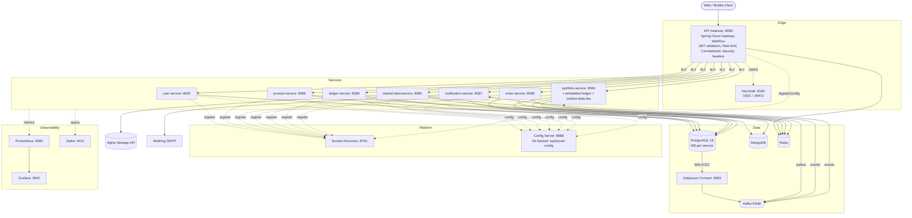

**Layers to talk about in the interview**

1. **Edge** – single entry point; cross-cutting concerns (auth, throttling, correlation id, HSTS/CSP headers).
2. **Platform** – service registry (client-side load balancing via `lb://`), centralized externalized config (Git).
3. **Domain services** – each owns its data (Database-per-Service).
4. **Data & messaging** – Postgres (OLTP), Mongo (event store, read model, time-series), Redis (cache, cart, locks, rate limit), Kafka (events) + Debezium (CDC outbox relay).
5. **Observability** – metrics, distributed tracing, structured logs with correlation ids.

---

## 4. Service Catalogue

| Service | Port | Bounded context | Datastores | Talks to |
|---|---|---|---|---|
| **api-gateway** | 8080 | Edge routing, security, throttling | Redis (rate-limit buckets) | All services via Eureka |
| **discovery-server** | 8761 | Eureka registry | – | – |
| **config-server** | 8888 | Git-backed config | Git repo `equitycart-config` | – |
| **user-service** | 8081 | Identity, profile, KYC, wallet, roles | PG `equitycart_user` | – |
| **product-service** | 8089 | Catalog & inventory | PG `equitycart_product`, Redis cache | – |
| **order-service** | 8088 | Cart, orders, flash sale | PG `equitycart_order`, Redis (cart, locks) | product-service (Feign), Kafka producer |
| **portfolio-service** | 8084 | Holdings, rewards, trades, sagas, alerts, CQRS, event sourcing | PG `equitycart_portfolio`, Mongo `equitycart_portfolio`, Redis | product & order (Feign), Kafka consumer+producer, embeds ledger + market-data modules |
| **market-data-service** | 8085 | Stock quotes, price history, SSE streaming | Mongo `equitycart_marketdata`, Redis | Alpha Vantage (WebClient + Resilience4j) |
| **ledger-service** | 8086 | Double-entry bookkeeping | PG `equitycart_ledger` | – |
| **notification-service** | 8087 | Email/Webhook/Log dispatch | PG `equitycart_notification` | Kafka consumer, SMTP |
| **commons** (lib) | – | Shared DTOs, events, exceptions, Feign clients, security, Kafka DLT config | – | – |
| **app** (lib/monolith) | 8082 | Original modular monolith aggregator | PG `equitycart` | – |

### Gateway routes (`equitycart-config/api-gateway.yml`)

| Path predicate | Target |
|---|---|
| `/api/auth/**`, `/api/users/**` | `lb://user-service` |
| `/api/order/**`, `/api/cart/**` | `lb://order-service` |
| `/api/portfolio/**` (+ `/api/v2/portfolio/**` CQRS read API in the same service) | `lb://portfolio-service` |
| `/api/market-data/**` | `lb://market-data-service` |
| `/api/ledger/**` | `lb://ledger-service` |
| `/api/notifications/**` | `lb://notification-service` |
| `/api/products/**`, `/api/categories/**`, `/api/brands/**`, `/api/brand-ticker-mappings/**` | `lb://product-service` |

Open paths (no JWT): `/api/auth/**`, `/actuator/**`. Default filter: Redis `RequestRateLimiter` (replenish 10/s, burst 20, keyed by userId or IP).

---

## 5. Service Relationship Diagram

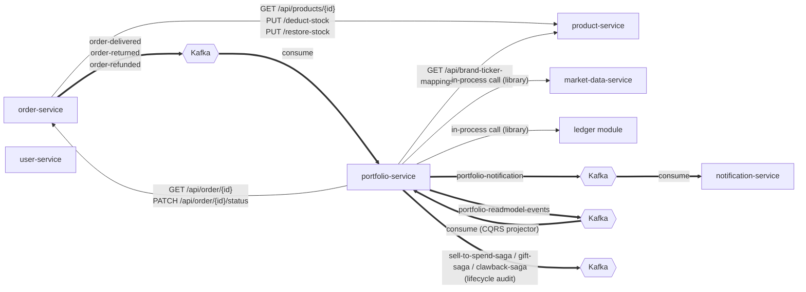

### Kafka topic map

| Topic | Producer (mechanism) | Consumer (group) | Purpose |
|---|---|---|---|
| `order-delivered` | order-service (outbox → poller / Debezium) | portfolio `equitycart-reward-group` | Grant stock-back rewards |
| `order-returned` | order-service (outbox) | portfolio `equitycart-cancellation-group` | Cancel PENDING rewards / start Clawback saga for VESTED |
| `order-refunded` | order-service (outbox) | portfolio `equitycart-refund-group` | Restore shares sold via Sell-to-Spend |
| `portfolio-notification` | portfolio `NotificationPublisher` (direct `KafkaTemplate`) | notification `equitycart-notification-group` | Trade / vest / alert / S2S notifications |
| `portfolio-readmodel-events` | portfolio (outbox `portfolio_outbox_events`) | portfolio `portfolio-readmodel-projection-group` | Rebuild Mongo CQRS read model |
| `sell-to-spend-saga`, `gift-saga`, `clawback-saga` | portfolio (outbox) | – (observability/audit) | Saga lifecycle events |
| `<topic>.DLT` | `DeadLetterPublishingRecoverer` (commons) | ops | Poison messages after exponential retries |

Message key = aggregate id (orderId / userId) → **per-aggregate ordering** within a partition.

---

## 6. Database-per-Service Mapping

```mermaid
flowchart TB
    subgraph PG[PostgreSQL 16 - one instance, separate logical DBs - init-db.sh]
        DBU[(equitycart_user)]
        DBP[(equitycart_product)]
        DBO[(equitycart_order)]
        DBPF[(equitycart_portfolio)]
        DBL[(equitycart_ledger)]
        DBN[(equitycart_notification)]
        DBK[(keycloak)]
        DBM[(equitycart - legacy monolith)]
    end
    subgraph MONGO[MongoDB]
        M1[(equitycart_portfolio<br/>portfolio_events<br/>portfolio_read_models)]
        M2[(equitycart_marketdata<br/>price_history)]
    end
    subgraph REDIS[Redis]
        R1[Cart:userId - hash]
        R2[price:SYMBOL - 30s]
        R3[flash_sale:lock:productId]
        R4[product / products cache - 10m]
        R5[request_rate_limiter.*]
    end

    user-service --> DBU
    product-service --> DBP & R4
    order-service --> DBO & R1 & R3
    portfolio-service --> DBPF & M1 & R2
    ledger-service --> DBL
    notification-service --> DBN
    market-data-service --> M2 & R2
    api-gateway --> R5
    Keycloak --> DBK
```

| Service | Store | Tables / Collections / Keys |
|---|---|---|
| user-service | PG `equitycart_user` | `users`, `user_profiles`, `kyc_details`, `wallet_accounts`, `roles`, `user_roles`, `refresh_tokens` |
| product-service | PG `equitycart_product` | `brands`, `categories`, `products`, `brand_ticker_mappings` (+ Spring Batch `BATCH_*` meta tables) |
| order-service | PG `equitycart_order` | `orders`, `order_items`, `outbox_events` |
| portfolio-service | PG `equitycart_portfolio` | `portfolios`, `holdings`, `stock_back_rewards`, `sell_to_spend_sagas`, `gift_sagas`, `clawback_sagas`, `price_alerts`, `alert_audit_logs`, `portfolio_outbox_events`, `ledger_entries` (embedded ledger module) |
| portfolio-service | Mongo `equitycart_portfolio` | `portfolio_events` (event store), `portfolio_read_models` (CQRS) |
| ledger-service | PG `equitycart_ledger` | `ledger_entries` |
| notification-service | PG `equitycart_notification` | `notification_logs` |
| market-data-service | Mongo `equitycart_marketdata` | `price_history` (TTL 90d) |

**Common columns** – every JPA entity extends `BaseEntity` (`@MappedSuperclass`):

| Column | Type | Notes |
|---|---|---|
| `id` | `bigint` PK | `IDENTITY` (except `products` → sequence `product_id_seq`, allocationSize 50 for batch inserts) |
| `created_at` | `timestamp` | set in `@PrePersist`, not updatable |
| `updated_at` | `timestamp` | set in `@PrePersist` / `@PreUpdate` |

Java→SQL conventions: `camelCase` → `snake_case`; `BigDecimal` money → `numeric(19,4)`; share quantities → `numeric(19,6)` (fractional shares); enums → `varchar` (`EnumType.STRING`, safe against re-ordering); `@Version` → `bigint` optimistic lock column.

---

## 7. Detailed ER Diagrams & Table Mappings

### 7.1 user-service — `equitycart_user`

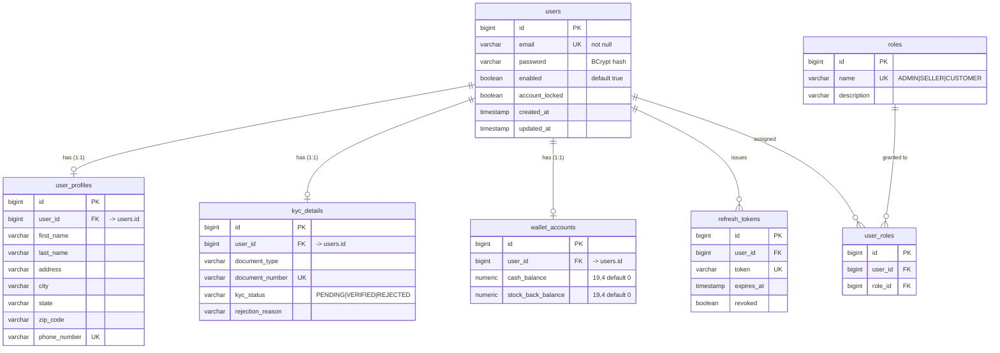

| Entity → Table | Relationship (JPA) | Key constraints |
|---|---|---|
| `User` → `users` | root aggregate | `email` UNIQUE |
| `UserProfile` → `user_profiles` | `@OneToOne(LAZY) @JoinColumn(user_id)` | `phone_number` UNIQUE |
| `KycDetail` → `kyc_details` | `@OneToOne(LAZY)` | `document_number` UNIQUE |
| `WalletAccount` → `wallet_accounts` | `@OneToOne(LAZY)` | – |
| `Role` / `UserRole` | M:N via explicit join entity (`@ManyToOne` ×2) | UNIQUE(`user_id`,`role_id`) `unique_user_role` |
| `RefreshToken` | `@ManyToOne(LAZY)` | `token` UNIQUE; rotation + revocation |

> Why an explicit `UserRole` entity instead of `@ManyToMany`? It gives auditing columns (`created_at`) and allows future attributes (granted_by, expiry).

### 7.2 product-service — `equitycart_product`

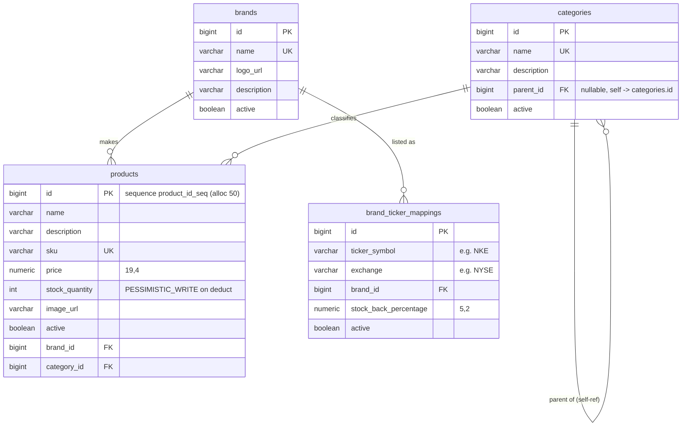

| Highlights |
|---|
| `products.stock_quantity` is mutated **only** via `ProductRepository.findByIdForUpdate` with `@Lock(PESSIMISTIC_WRITE)` → `SELECT … FOR UPDATE` → no overselling. |
| UNIQUE(`ticker_symbol`,`brand_id`) `unique_ticker_brand` – a brand can map to multiple tickers (e.g. dual listing), each with its own stock-back %. |
| `categories.parent_id` self-reference → arbitrary-depth tree (`/top-level`, `/{parentId}/subcategories`). |
| Bulk CSV import via **Spring Batch** (`ProductBatchConfig`) – chunked writes, sequence allocation 50 avoids one round-trip per id. |
| Reads cached in Redis (`@Cacheable("product")`, `@Cacheable("products")`, TTL 10 min) with `@CacheEvict` on writes / stock changes. |

### 7.3 order-service — `equitycart_order`

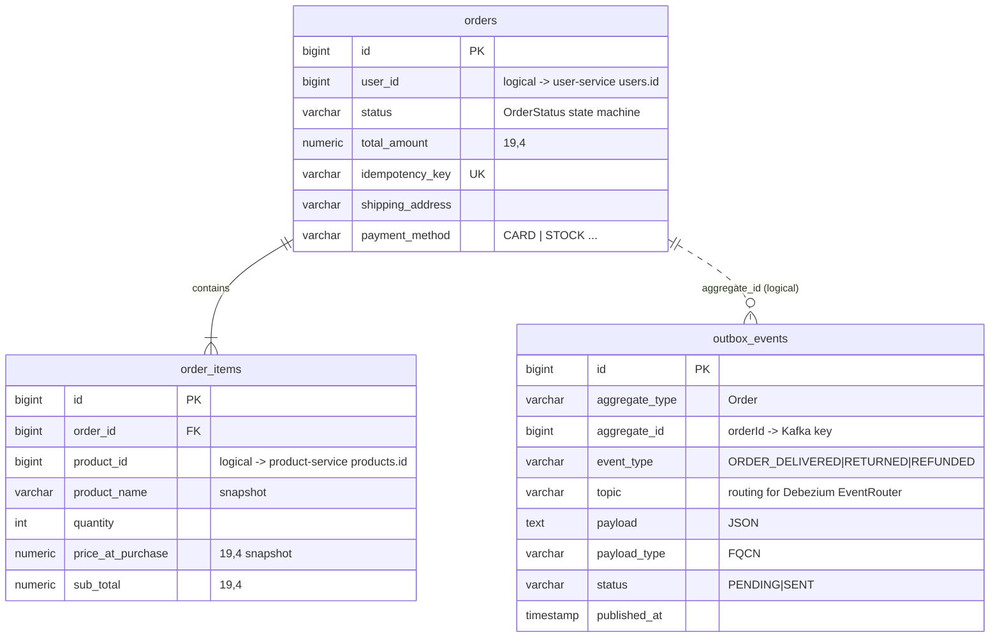

**Order state machine** (`OrderStatus.canTransitionTo`):

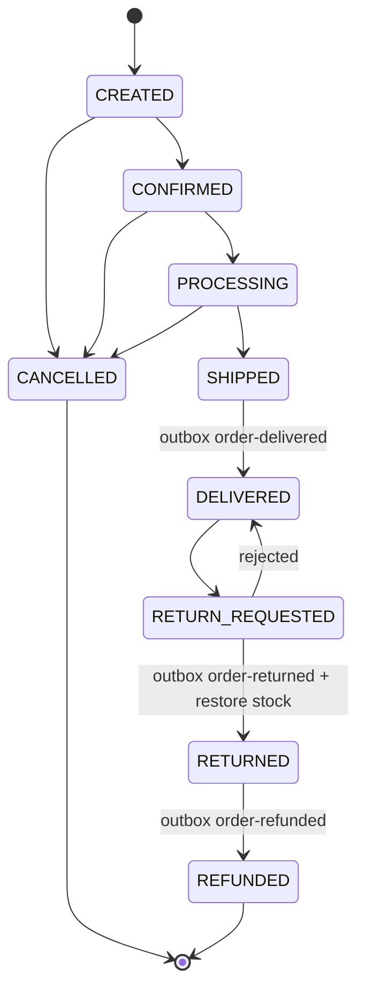

Design notes: `orders` is a reserved word → table `orders`; `product_name` / `price_at_purchase` are **snapshots** (denormalized) so historical orders don't change when the catalog does — and order-service never needs to join across services.

### 7.4 portfolio-service — `equitycart_portfolio` (PostgreSQL)

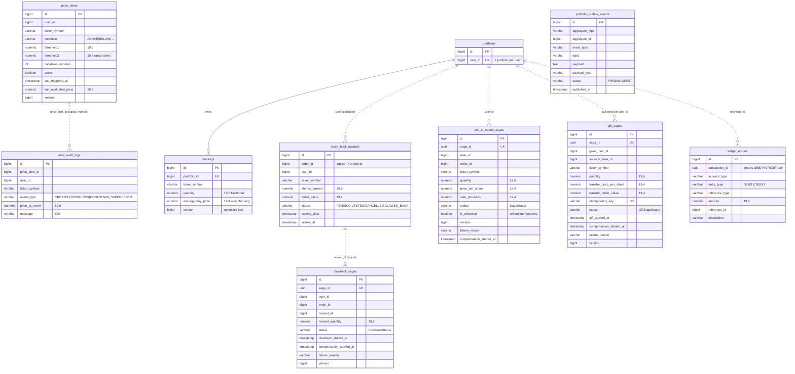

| Table | Constraints / Indexes | Why |
|---|---|---|
| `portfolios` | UNIQUE(`user_id`) | One portfolio per user; lazy-created on first reward/trade |
| `holdings` | UNIQUE(`portfolio_id`,`ticker_symbol`) `uk_portfolio_ticker`; `@Version` | One row per ticker; optimistic locking for concurrent trades/vesting |
| `stock_back_rewards` | UNIQUE(`order_id`,`ticker_symbol`) `uk_order_ticker` | **Idempotent consumer** — redelivered `order-delivered` events cannot double-grant |
| `*_sagas` | UNIQUE(`saga_id`), `gift_sagas.idempotency_key` UNIQUE, `@Version` | Durable saga state machine; safe concurrent timeout recovery |
| `price_alerts` | IDX(`user_id`,`active`), IDX(`ticker_symbol`,`active`); `@Version` | List user alerts; scheduler fetches active alerts per ticker |
| `alert_audit_logs` | IDX(`price_alert_id`) | Alert history endpoint |

**Saga state machines**

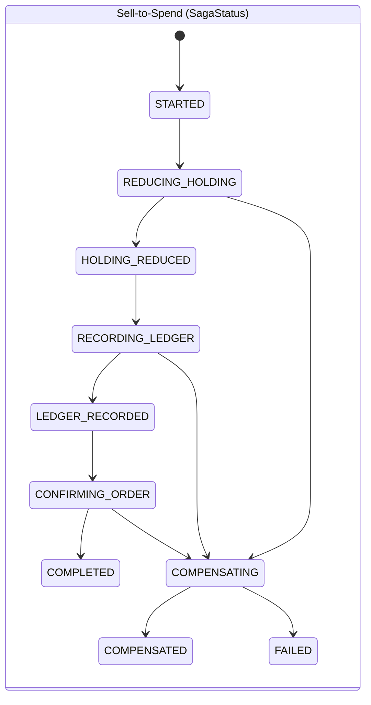

- **GiftSagaStatus**: `INITIATED → DEBITING_GIVER → GIVER_DEBITED → CREDITING_RECEIVER → RECEIVER_CREDITED → RECORDING_LEDGER → LEDGER_RECORDED → COMPLETED` (else `COMPENSATING → COMPENSATED | FAILED`). Timeout scan every 30 s.
- **ClawbackStatus**: `INITIATED → CHECKING_ELIGIBILITY → REDUCING_HOLDING → HOLDING_REDUCED → RECORDING_LEDGER → LEDGER_RECORDED → UPDATING_REWARD_STATUS → COMPLETED` (else compensation). Timeout scan every 5 min.

### 7.5 ledger — `equitycart_ledger` (and embedded in `equitycart_portfolio`)

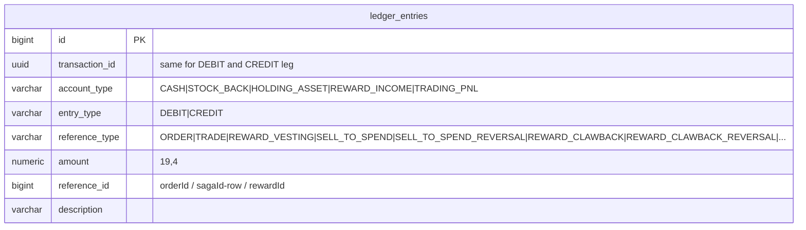

Append-only, never updated. Invariant: `SUM(DEBIT) = SUM(CREDIT)` per `transaction_id`. Reversals are new entries (`*_REVERSAL`), never deletes — this is what makes compensation auditable.

| Business action | DEBIT | CREDIT |
|---|---|---|
| BUY trade | HOLDING_ASSET | CASH |
| SELL trade | CASH | HOLDING_ASSET |
| Reward vesting | HOLDING_ASSET | REWARD_INCOME |
| Sell-to-Spend | CASH | HOLDING_ASSET |
| Sell-to-Spend reversal | HOLDING_ASSET | CASH |

### 7.6 notification-service — `equitycart_notification`

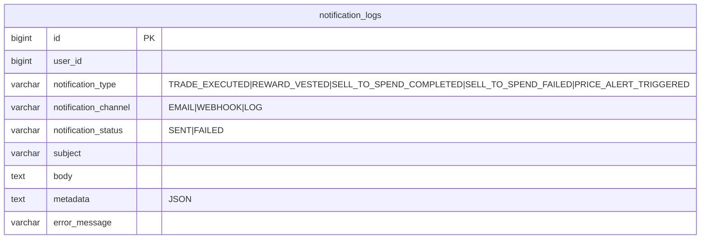

Channel chosen by **Strategy pattern** (`NotificationChannelStrategy` → Email / Webhook / Log), configured via `equitycart.notification.channel`.

---

## 8. NoSQL, Cache & Messaging Data Mapping

### 8.1 MongoDB

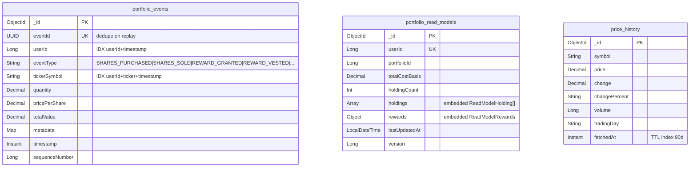

| Collection | DB | Pattern | Notes |
|---|---|---|---|
| `portfolio_events` | `equitycart_portfolio` | **Event Sourcing** (append-only) | `/api/portfolio/events/projection` replays events to rebuild holdings; `/projection/validate` compares against Postgres |
| `portfolio_read_models` | `equitycart_portfolio` | **CQRS read side** | Denormalized doc per user (`holdings[]` + `rewards{}` embedded) → single-document read, no joins. Upsert by `userId` = idempotent. Behind feature flag `feature-flags.portfolio.cqrs-read-enabled`. Daily reconciliation job + bootstrapper |
| `price_history` | `equitycart_marketdata` | Time-series w/ TTL | Auto-expiry after 90 days keeps collection bounded |

### 8.2 Redis keyspace

| Key pattern | Type | TTL | Owner | Purpose |
|---|---|---|---|---|
| `Cart:{userId}` | Hash (`productId → item JSON`) | 30 min (sliding) | order-service | Ephemeral cart, no DB writes until checkout |
| `flash_sale:lock:{productId}` | String (`SET NX EX`, value = requestId) | `lock-ttl-seconds` (10 s) | order-service | Distributed lock; release via Lua compare-and-delete |
| `price:{SYMBOL}` | String JSON | 30 s | market-data (also portfolio via library) | Cache-aside for Alpha Vantage quotes (API limit 5/min) |
| `product::{id}`, `products::*` | Spring Cache | 10 min | product-service | Catalog read cache |
| `request_rate_limiter.{key}.tokens/.timestamp` | String | managed by Lua | api-gateway | Token-bucket rate limiting shared across gateway instances |

---

## 9. Cross-Service (Logical) Relationships

No foreign keys cross database boundaries. References are **IDs only**, resolved by API calls or carried in events (with snapshots).

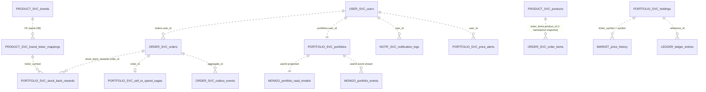

**Interview line:** *"Referential integrity across services is enforced by the business flow (validation via Feign, idempotent unique keys, sagas) rather than by the database. Each service stores the snapshot it needs, so it can keep working if the owner is down."*

---

## 10. Key Business Flows

### 10.1 Place order (cart → order)

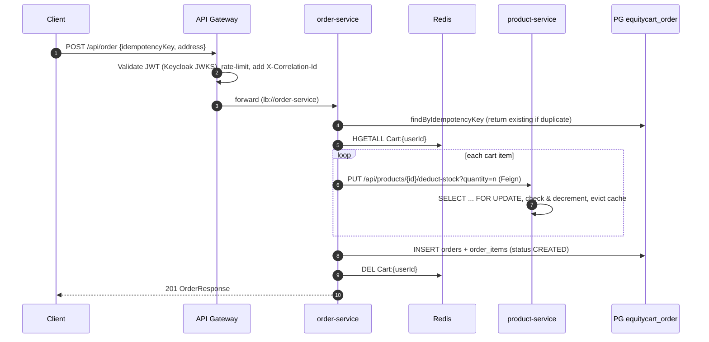

### 10.2 Flash sale (high contention)

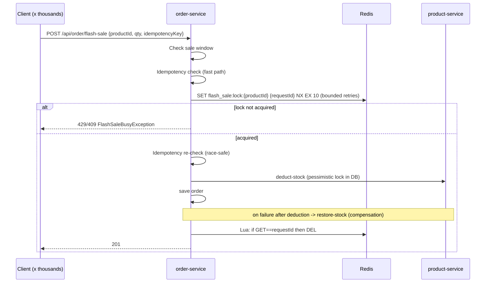

Two layers of protection: **Redis lock** sheds load *before* it hits Postgres; **DB row lock** is the correctness guarantee.

### 10.3 Delivery → stock-back reward (Transactional Outbox + Kafka)

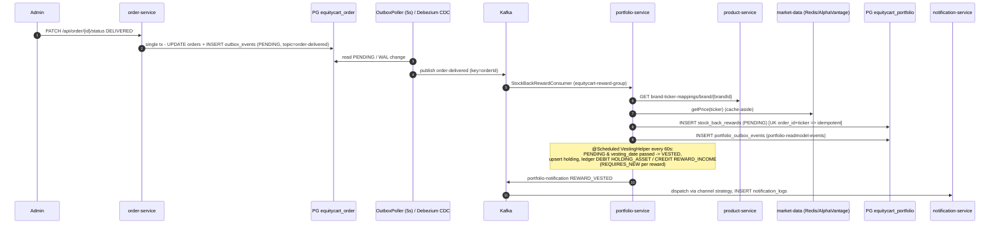

### 10.4 Sell-to-Spend (orchestrated saga)

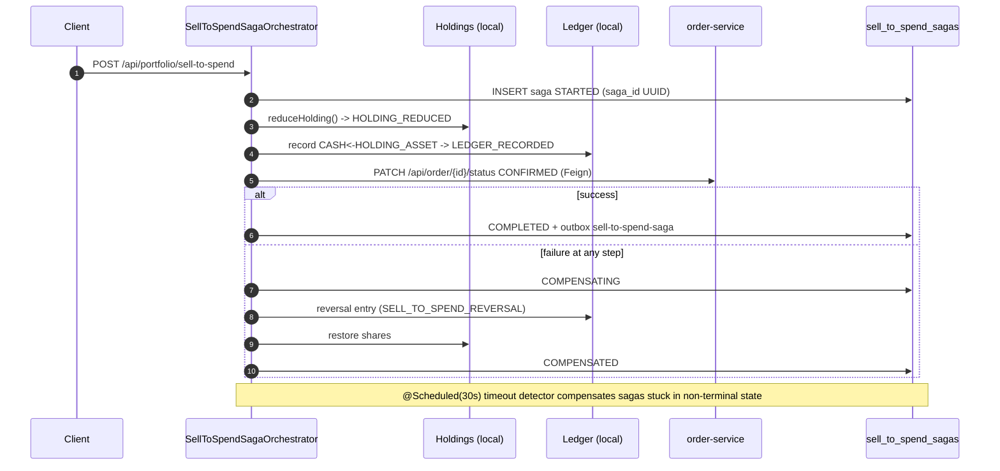

Strategy switch: `equitycart.sell-to-spend.strategy = saga | transactional` (`@ConditionalOnProperty`) — both implementations behind one interface, good for A/B and rollback.

### 10.5 Return → Clawback, Refund → restore

- `order-returned`: PENDING rewards → `CANCELLED` directly; VESTED rewards → **ClawbackSaga** (reduce holding, ledger `REWARD_CLAWBACK`, mark `CLAWED_BACK`; compensations `REWARD_CLAWBACK_REVERSAL`).
- `order-refunded`: if the order was paid with STOCK, restore sold shares; idempotent via `sell_to_spend_sagas.is_refunded`.

### 10.6 CQRS read path

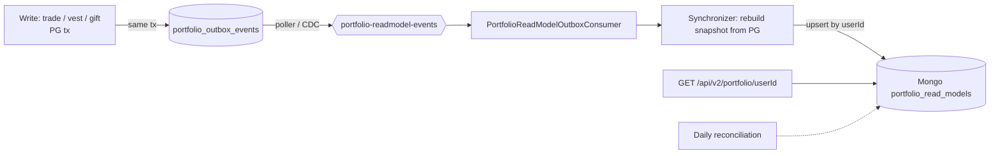

---

## 11. Patterns Used & Why

| Pattern | Where | Why |
|---|---|---|
| API Gateway | `api-gateway` | Single entry, central auth/rate limit/headers |
| Service Discovery (client-side LB) | Eureka + `lb://` + Feign | Elastic instances, no hard-coded hosts |
| Externalized Config | Config Server (Git) | Same artifact across envs, audit trail of config |
| Database per Service | 6 PG DBs + 2 Mongo DBs | Independent schema evolution & scaling |
| Transactional Outbox | `outbox_events`, `portfolio_outbox_events` | Atomic DB write + event publish (no dual-write) |
| CDC (Debezium EventRouter) | `cdc` profile disables pollers | Lower latency, no polling load, WAL-based |
| Orchestrated Saga + compensation | Sell-to-Spend, Gift, Clawback | Multi-step consistency without 2PC |
| Idempotent Consumer | UKs `uk_order_ticker`, `idempotency_key`, `eventId`, `is_refunded` | At-least-once Kafka delivery |
| CQRS | Mongo read model + feature flag | Fast reads, decoupled read scaling |
| Event Sourcing | `portfolio_events` | Audit, temporal queries, replay/validation |
| Double-entry ledger | `ledger_entries` | Financial correctness & auditability |
| Cache-aside | price:{SYMBOL}, product cache | Protect slow/limited dependencies |
| Distributed lock | Redis SET NX + Lua release | Flash-sale contention shedding |
| Pessimistic & optimistic locking | `FOR UPDATE` on stock, `@Version` on holdings/sagas/alerts | Correctness under concurrency |
| Circuit breaker / Retry / Rate limiter | Resilience4j on Alpha Vantage | Fault isolation; respect 5 req/min quota |
| Dead Letter Topic | `DefaultErrorHandler` + DLT (exp. backoff, max 10s) | Poison-pill isolation |
| Strategy | Notification channels, Sell-to-Spend strategy | Open/closed extension |
| Facade | `PortfolioFacade` | Simplify controller → multiple services |
| Feature flag | `cqrs-read-enabled`, `sell-to-spend.strategy` | Safe rollout |

---

## 12. Consistency, Concurrency & Idempotency

| Concern | Mechanism |
|---|---|
| Overselling | `PESSIMISTIC_WRITE` on `products` row inside product-service (single owner of stock) |
| Flash-sale thundering herd | Redis lock per product + bounded retries → fast 429 instead of DB pile-up |
| Duplicate order submits | `orders.idempotency_key` UNIQUE + check-before and check-after lock |
| Duplicate Kafka delivery | Unique business keys (`order_id+ticker`), saga `saga_id`, `is_refunded`, Mongo `eventId` UNIQUE, upsert by `userId` |
| Concurrent holding updates | `@Version` optimistic locking on `holdings` (retry on `OptimisticLockException`) |
| Lost events | Outbox in same local tx; relay is at-least-once |
| Partial failure across services | Saga with persisted state + scheduled timeout recovery + reverse compensation |
| Vesting batch isolation | `REQUIRES_NEW` per reward (one failure doesn't roll back the batch) |
| Event ordering | Kafka key = aggregate id → same partition → ordered per order/user |
| Read-model drift | Full-snapshot rebuild per event + daily reconciliation + bootstrapper |

**Consistency model summary:** strong consistency **inside** a service (ACID in Postgres), **eventual consistency between** services (events + sagas).

---

## 13. Security Design

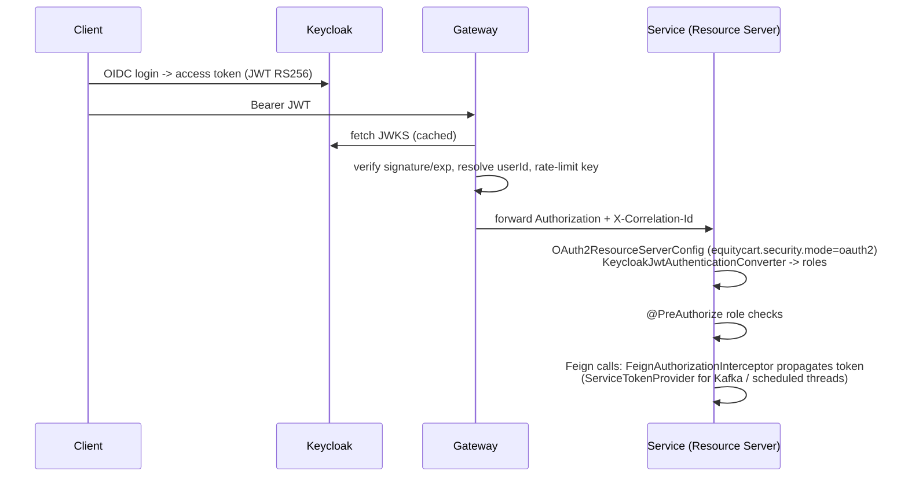

- **Defense in depth:** gateway validates *and* each service validates (zero-trust inside the network).
- user-service also supports the custom HS256 JWT path (`security.mode=custom`, access 15 min / refresh 7 days with rotation & revocation in `refresh_tokens`).
- Security headers at edge: HSTS, CSP, X-Frame-Options DENY, nosniff, Referrer-Policy, Permissions-Policy.
- Passwords BCrypt; secrets via env vars (`JWT_SECRET`, `ALPHA_VANTAGE_API_KEY`) — production should use Vault/K8s secrets.

---

## 14. Observability

| Signal | Tooling | Detail |
|---|---|---|
| Metrics | Micrometer → Prometheus → Grafana | `/actuator/prometheus`; custom `OrderMetrics`, `PortfolioMetrics`, `NotificationMetrics` |
| Tracing | Micrometer Tracing (Brave) → Zipkin | sampling 1.0 (dev); spans propagate over HTTP + Feign |
| Correlation | `CorrelationIdGatewayFilter` → `MdcCorrelationFilter` → `FeignCorrelationInterceptor` | `X-Correlation-Id` in every log line (`%X{correlationId}`) |
| Logs | Log4j2 → `/logs` volume (Fluentd/ELK prepared, disabled locally) | |
| Health | Actuator `/health` with details | Used by Eureka & orchestrators |

---

## 15. Scaling Strategy

### 15.1 Where load concentrates

| Hot path | Characteristic | Bottleneck |
|---|---|---|
| Catalog browse | Read-heavy, cacheable | product DB reads |
| Cart | Write-heavy, ephemeral | — (Redis) |
| Checkout / flash sale | Write-contended on a few rows | `products` row locks |
| Portfolio view | Read-heavy, aggregation | joins over holdings/rewards |
| Price quotes | External API limited to 5/min | Alpha Vantage quota |
| Events | Bursty on delivery batches | consumer throughput |

### 15.2 Scaling each tier

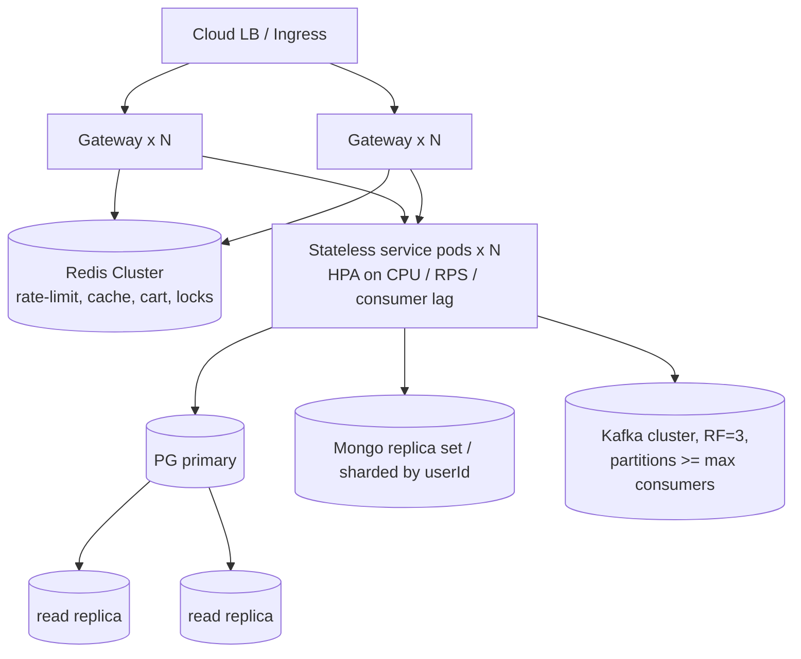

1. **Stateless services → horizontal scaling.** All services keep state in PG/Mongo/Redis, so add pods; Eureka/K8s Service load-balances. Gateway rate-limit buckets live in Redis, so limits stay correct with N gateways.
2. **Kafka consumers.** Parallelism = partitions per topic. Scale portfolio consumers by increasing partitions of `order-delivered` and replicas in the same consumer group. Key by `orderId`/`userId` keeps ordering per aggregate. Monitor **consumer lag** for autoscaling (KEDA). Move to replication factor 3, `min.insync.replicas=2`, `acks=all`, idempotent producer.
3. **Read scaling.**
   - Catalog: Redis cache (10 min) + PG read replicas; CDN for images; later Elasticsearch for search.
   - Portfolio: switch reads to **CQRS Mongo read model** (`cqrs-read-enabled=true`) — one document per user, scales independently (replica set reads / sharding on `userId`).
   - Market data: Redis 30 s cache absorbs fan-out — N users watching `AAPL` cost 1 upstream call per 30 s. SSE stream (`/stream/{symbol}`) polls cache every 5 s.
4. **Write scaling.**
   - Split the shared Postgres instance into **one instance per service** (today they are separate logical DBs on one server — easy to lift out).
   - `orders`, `order_items`, `ledger_entries`, `notification_logs`, `portfolio_events` grow unbounded → **partition by time** (PG declarative partitioning by `created_at` month) and archive cold partitions.
   - Shard by `user_id` when a single primary is not enough (portfolio, orders are naturally user-scoped; `uk_portfolio_ticker` stays shard-local).
   - Outbox: CDC (Debezium) instead of polling to remove `SELECT … WHERE status='PENDING'` load; add index on `(status, created_at)` and purge `SENT` rows.
5. **Hot-row contention (flash sale).**
   - Today: Redis lock + `SELECT FOR UPDATE`.
   - Next level: **pre-allocate stock into Redis** (`DECRBY` atomic counter / Lua) and reconcile asynchronously, or **inventory bucketing** (split 10k units into 10 rows of 1k to spread locks), plus a **queue-based admission** (virtual waiting room).
6. **External API limits.** Batch quotes (`/prices`), longer TTL during market close, fallback to last known `price_history`, circuit breaker already prevents cascading failure.
7. **Schedulers in a multi-instance world.** `@Scheduled` jobs (vesting, alert evaluation, saga timeouts, outbox poller, reconciliation) run on **every** replica → need **ShedLock** / leader election, or `SELECT … FOR UPDATE SKIP LOCKED` batching so replicas share work without duplicates.
8. **Platform HA.** Multiple Eureka peers (or K8s DNS), Config Server ×2 behind LB (or K8s ConfigMaps), Keycloak cluster, Redis Sentinel/Cluster, Mongo replica set.

### 15.3 Back-of-the-envelope (talking numbers)

| Assumption | Value |
|---|---|
| DAU | 1 M |
| Orders/day | 200 k → ~2.3 orders/s avg, ~25/s peak (10×) |
| Flash sale burst | 50 k req in 10 s → 5 k RPS on 1 product |
| Portfolio views | 5 per user/day → 5 M/day → ~60 RPS avg, ~600 peak |
| Ledger rows | ~2 rows per financial event ≈ 1–2 M rows/day → partition monthly |

- 5 k RPS flash sale: Redis handles ~100k ops/s per node; the lock admits one buyer per product at a time, so most requests fail fast (429) — meaning DB sees only successful buyers. For higher throughput, Redis-counter inventory.
- 600 RPS portfolio reads: single Mongo doc lookup by unique `userId` index → trivially served by a replica set.

---

## 16. Failure Modes & Resilience

| Failure | Behaviour |
|---|---|
| Kafka down | Outbox rows remain `PENDING`; relay retries; no data loss, delayed rewards |
| Portfolio down during delivery | Events wait in Kafka (offsets not committed); processed on recovery |
| Poison message | Exponential retry (capped 10 s) → `<topic>.DLT`; non-retryable exceptions go straight to DLT |
| product-service down during checkout | Feign error → `FeignErrorDecoder` maps to domain exception; order tx rolls back (already-deducted stock is restored in flash-sale path) |
| Crash mid-saga | Persisted saga status + `@Scheduled` timeout detector compensates |
| Alpha Vantage outage / quota | Retry ×3 → Circuit breaker (50 % / 10 calls, 30 s open) → fallback; Redis cache serves recent quotes |
| Redis down | Rate limiter fails (500) — recommend fail-open; cart unavailable; caches bypassed |
| Mongo read model stale | Feature flag falls back to Postgres legacy path; reconciliation rebuilds |
| Config server down | Services already running keep config; `optional:configserver` for discovery bootstrap |

---

## 17. Trade-offs, Known Gaps & Evolution

| Topic | Current | Trade-off / Improvement |
|---|---|---|
| portfolio embeds ledger + market-data as **libraries** | In-process calls, `ledger_entries` also in `equitycart_portfolio` | Lower latency & local ACID for trade+ledger, but tighter coupling; extract to async ledger events when ledger must scale independently |
| One Postgres server, many DBs | Simple local ops | Single point of failure / noisy neighbour → separate instances |
| `ddl-auto: update` | Fast iteration | Use Flyway/Liquibase migrations (`validate` already in shared config) |
| Outbox poller every 5 s | Simple | Use CDC (`cdc` profile + Debezium). **Note:** the portfolio Debezium connector watches `public.outbox_events`, while portfolio writers persist to `portfolio_outbox_events` — align `table.include.list` before relying on CDC for portfolio events |
| Full read-model rebuild per event | Correctness-first | Delta projections if CPU becomes a bottleneck |
| `@Scheduled` jobs on every replica | Fine for 1 instance | ShedLock / SKIP LOCKED for multi-instance |
| Saga lifecycle topics have no consumer | Audit only | Feed into analytics / ops dashboards |
| Tracing sampling 1.0 | Dev | 0.05–0.1 in prod, tail-based sampling |
| Synchronous stock deduction per cart line | Simple | Batch deduct endpoint; or reservation pattern (reserve → confirm → release on timeout) |

**Evolution story to narrate:** Monolith (`app`, one DB) → modular monolith with packages per domain → extract product & order (Feign) → event-driven (Kafka + outbox) → sagas for cross-service money flows → CQRS/Event sourcing for portfolio → gateway + Keycloak + observability → (next) Kubernetes, per-service DB instances, CDC everywhere.

---

## 18. Interview Q&A Cheat Sheet

**Q: Why microservices here?**
Different scaling profiles (catalog reads vs. flash-sale writes vs. portfolio reads vs. event processing), different consistency needs (ledger strict, notifications best-effort), independent deployability.

**Q: How do you avoid the dual-write problem?**
Transactional Outbox: business row + `outbox_events` row in one local transaction; a poller or Debezium publishes to Kafka. Consumers are idempotent because delivery is at-least-once.

**Q: Why orchestration rather than choreography for sagas?**
Money flows need a single place that knows the step order, persists state, detects timeouts and runs compensation in reverse. Choreography is used for simpler fan-out (order → rewards → notifications).

**Q: Why can't step 3 (order confirmation) of Sell-to-Spend be compensated?**
It commits in another service's DB. We order steps so the irreversible/remote step is last; failures before it compensate locally, and timeouts re-drive after crashes.

**Q: How do you prevent double rewards?**
`UNIQUE(order_id, ticker_symbol)` on `stock_back_rewards` + separate consumer groups + DLT. Replays become no-ops.

**Q: How do you guarantee no overselling during a flash sale?**
Redis `SET NX EX` lock per product to throttle, idempotency key checked before and after lock, and `SELECT … FOR UPDATE` in product-service as the source of truth; compensation (`restore-stock`) if the order save fails after deduction.

**Q: Why both Postgres and Mongo for portfolio?**
Postgres is the write model (ACID, constraints, optimistic locking). Mongo stores (a) an append-only event log for audit/replay and (b) a denormalized read model so a portfolio page is one document fetch.

**Q: How would you scale to 10× traffic?**
HPA on stateless services, Kafka partitions + consumer lag autoscaling, CQRS reads from Mongo replicas, PG read replicas & time partitioning, per-service DB instances, Redis cluster, ShedLock for schedulers, CDC instead of polling, Redis-based inventory counters for flash sales.

**Q: What happens if Redis goes down?**
Rate limiter fails closed (should be fail-open with circuit breaker), cart is lost (acceptable—ephemeral, could persist to DB), caches miss and fall back to DB/API, flash-sale lock unavailable → reject flash-sale requests rather than risk DB overload.

**Q: How do you trace a request across services and Kafka?**
Gateway generates `X-Correlation-Id`, MDC filter puts it in logs, Feign interceptor forwards it, Micrometer/Brave propagates trace context to Zipkin; Kafka headers carry trace context.

**Q: Why double-entry ledger?**
Every financial event produces a balanced DEBIT/CREDIT pair under one `transaction_id`; reversals are new entries. You can always prove balances and reconstruct history — essential once shares become money (Sell-to-Spend).
